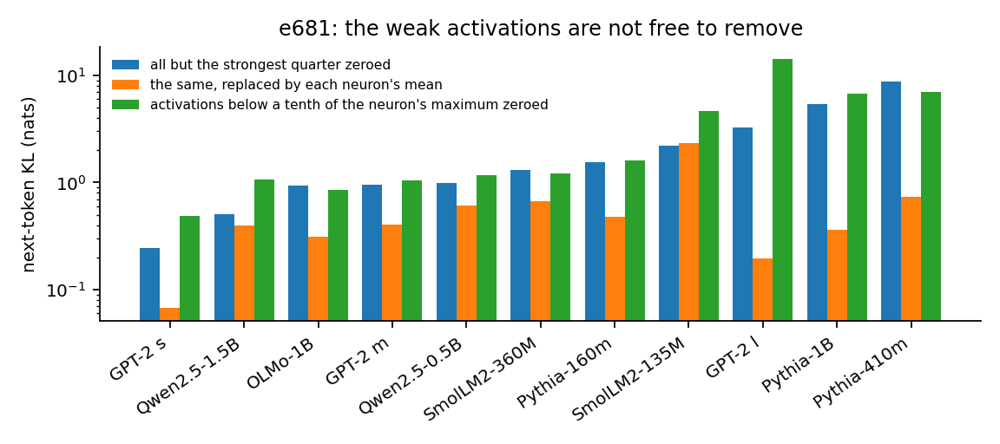
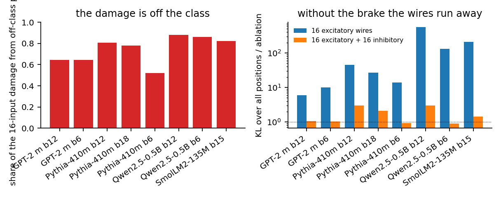
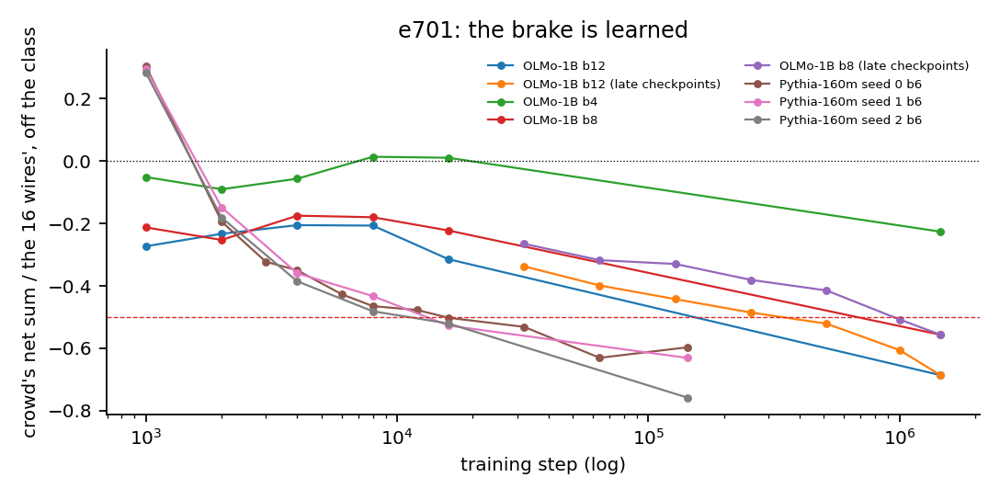
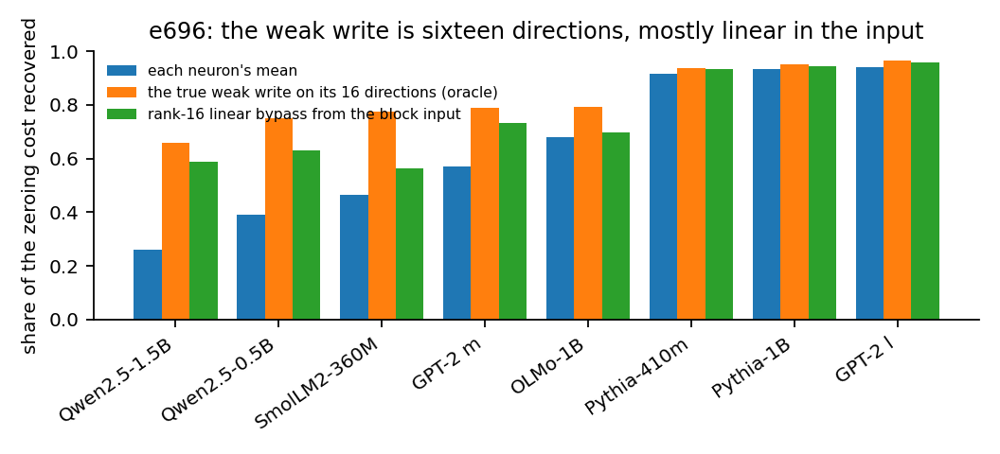
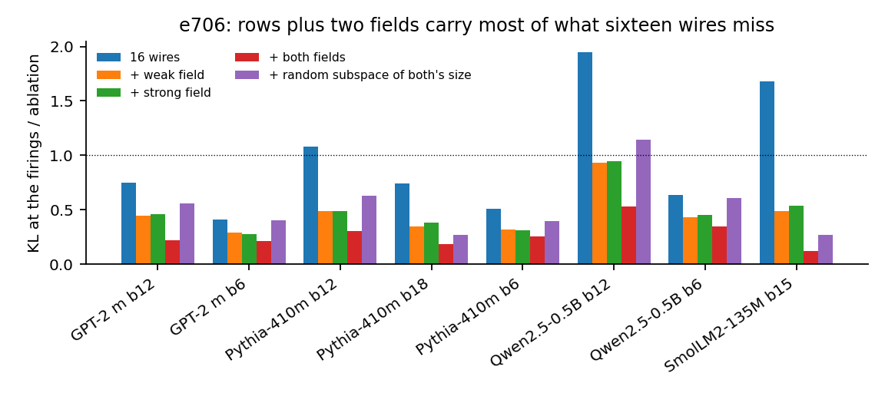
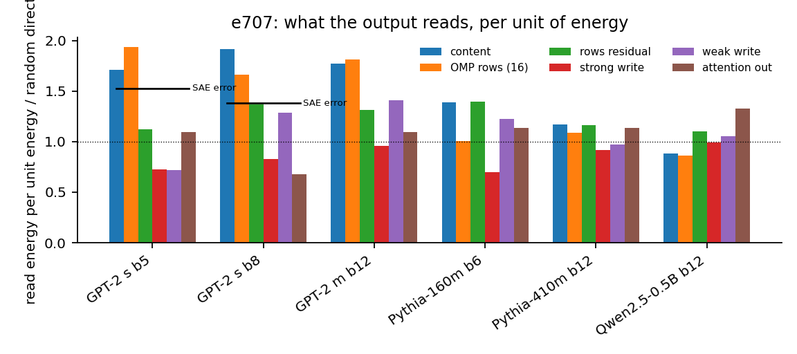
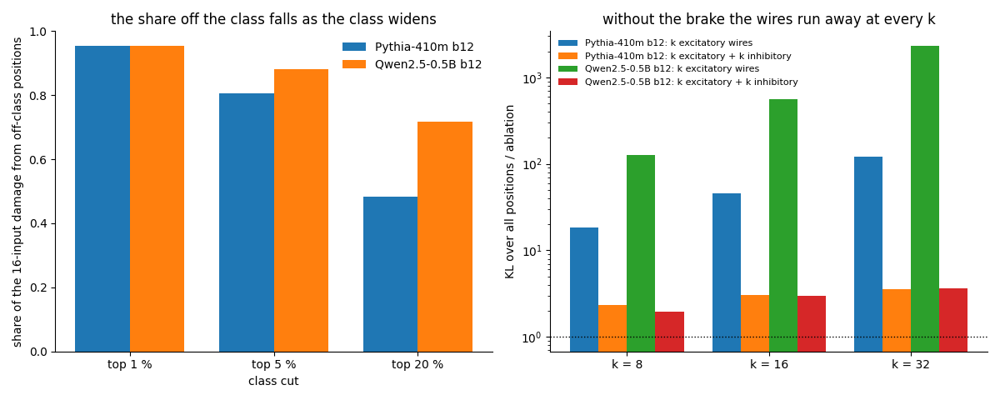

# The weak activations are a brake

**Eight pre-registered results on what the sub-threshold activations of a transformer's MLP neurons do, from an exact ledger of each neuron's inputs**

Ronish Bhatt, with Claude (Anthropic) as the experimenter. 20 October 2026. A technical note from the WDD descendants program. Code, results and pre-registrations: this repository (`wdd/`, `scripts/`, `results/`, `docs/atlas/` areas 62 to 71).

## Read this first

Eight pre-registered results and a robustness round, one exact instrument, models from 70M to 7B. The question: do the weak activations of a transformer's MLP neurons matter, and what do they do? Both sides of the "already clean" debate left it open.

1. **They matter.** Keep only the strongest quarter of each neuron's activations and next-token KL rises by 0.24 to 8.68 nats in eleven models; replacing them by each neuron's mean still leaves 0.07 to 2.31; at 7B, 1.57 and 0.88. (sections 3.1, 4)
2. **They are a brake.** A neuron driven by its sixteen largest inputs alone misfires off its class, where the crowd of thousands of small inputs would have held it down: 52 to 88 percent of the damage is off-class, sixteen excitatory wires alone cost 6 to 561 times the neuron's ablation damage, and sixteen inhibitory wires bring that to 0.6 to 3. At 7B: 85 to 87 percent, 59 to 284 times, 1.1 to 2.7. The same holds with eight to thirty-two wires, class cuts of 1 to 20 percent and on the Pile, and the medians over neurons carry narrow intervals where the brake is strong and wide ones at GPT-2 medium. (sections 3.2, 3.7, 4)
3. **The brake is learned.** The crowd pushes with the wires at step 1000 of Pythia-160m, crosses zero by step 2000 and reaches -0.6 to -0.8 at the end, monotone in three seeds; in OLMo-1B it crosses -0.5 at a third to two thirds of training, and in Pythia-410m by step 8000 of 143000. (section 3.3)
4. **It is low-rank and linear in the input.** A block's weak write lives in sixteen directions, and a closed-form rank-16 linear map from the block's input, with the weak neurons never run, recovers 0.56 to 0.96 of the zeroing cost while explaining less than half the weak write's variance. (section 3.4)
5. **Those directions are a second kind of atom.** Sixteen wires plus the weak field plus a strong-write field bring a pruned neuron's error at its firings from 0.41 to 1.95 of the ablation damage to 0.12 to 0.53, and from 0.9 and 2.9 to 0.5 and 1.0 at 7B. (sections 3.5, 4)
6. **The output grades by a quadratic form, not by energy.** The Fisher information of the model's own next tokens predicts the cost of removing any part of a state at Spearman 0.83 to 0.92; by it the fields are read at about twice a random direction and a public SAE's error at exactly its share of the energy. (section 3.6)
7. **A trained dictionary beats the native rows on a state, by a little on GPT-2 small and by a fifth on Pythia-160m, and the fields add nothing there.** Against jbloom's L1 dictionary the native rows win the response to interventions over the encoder's top sixteen latents (0.65 to 0.72 against 0.53 to 0.60); against OpenAI's and EleutherAI's TopK dictionaries the encoder's top sixteen win both scores (reconstruction 0.90 to 0.98 against 0.72 to 0.95, intervention 0.83 to 0.95 against 0.65 to 0.89) and beat pursuit over their own directions. In every run the fields add 0.00 to 0.01. (section 3.8)
8. **On the readers' turf a public SAE carries a neuron's brake as well as the fields do, and its error carries none of it.** As a GPT-2 small neuron's input the SAE's full reconstruction leaves 0.17 to 0.21 of the ablation damage at the firings and 0.31 to 0.32 over all positions, against 0.14 to 0.18 and 0.35 to 0.42 for sixteen wires plus both fields; the wires plus the SAE's error leave 0.30 to 0.32. (section 3.9)

What it settles: the weak activations are neither removable noise nor a store of individually meaningful facts. They are a collective, learned, low-rank, mostly linear brake on the model's own strong neurons, carried by a field that neither camp has named; and training defends none of these atoms one at a time, only the function (section 5). Is the brake just a bias, or an artefact of sixteen wires and a five percent class? Five controls say no (section 3.7), the brake holds on the Pile and forms by step 8000 at Pythia-410m, and the cost of the weak activations is 1.57 nats at 7B (section 4). Against trained dictionaries the native rows lose a reconstruction score, by a few hundredths on GPT-2 small and a fifth on Pythia-160m, and the fields add nothing to a reconstruction: a field is an atom for a neuron's readers, not for a position's state, and on the readers' turf it ties a sixty-latent SAE reconstruction with sixteen directions (sections 3.8, 3.9).

Reproduce the instrument on GPT-2 small in under a minute: `python -m wdd.demo_gpt2_small --fast` from this repository (section 7). Table 1 in section 3 lists every pre-registered statement with how many runs it held in.

## Abstract

Most of a transformer MLP neuron's activations are small, and the two positions in this month's debate disagree about what they do: the "already clean" position holds that they can be removed at little cost, its critics that they store facts in superposition. Through an exact accounting of every neuron's inputs, we show that both pictures miss the object. Keeping only the strongest quarter of each neuron's activations costs 0.24 to 8.68 nats of next-token KL in eleven models, and the cost is not an offset that the neuron's mean restores. A neuron driven by its sixteen largest inputs alone misfires away from its class, where the thousands of small inputs would have held it down: that silence is what the weak activations do, and sixteen excitatory wires alone cost 6 to 561 times the neuron's ablation damage. The brake is learned during training, it lives in sixteen directions per block, and a closed-form rank-16 linear map from the block's input reproduces most of it without running the weak neurons; those directions form a second kind of dictionary atom that halves the error of a pruned neuron graph. The same measurements at Qwen2.5-7B in fp32 give the same shape; the brake's numbers hold for eight to thirty-two wires, class cuts of 1 to 20 percent and the Pile, its formation repeats at Pythia-410m, the cost of the weak activations is 1.57 nats at 7B, and bootstrap intervals over neurons are narrow wherever the brake is strong. Against three public sparse autoencoders the native rows lose a reconstruction score by a few hundredths to a fifth and the fields add nothing to that score; as a neuron's input, an autoencoder's reconstruction carries the brake as well as the fields do, and its error does not. We interpret the results as a dictionary with two kinds of atom, native rows and collective fields, and show by a Fisher-information grade that the model's output reads neither camp's currency above its energy.

## 1. Introduction

A transformer's MLP neuron fires strongly on a small fraction of positions and weakly on the rest. Whether the weak part matters is the point on which the "already clean" debate of 15 to 20 October 2026 turns. Cammarata's essay (Goodfire) holds that a neuron's job is read off its strongest activations and that "almost all weak activations can be removed for almost no cost"; its critics (Gao, "Neural networks are not already clean"; Nanda's comments) hold that the weak activations carry memorised facts in superposition and cannot be dropped. StefanHex's summary of the first week named this the open question until Goodfire's technical companion appears. Both sides argue from what a neuron's activations look like; neither has measured what the weak activations do to the rest of the network.

That measurement is available. A neuron's pre-activation is a linear function of its block's normalised input, and that input is a sum of the writes of every unit before it, so the pre-activation splits exactly into one contribution per upstream unit. With that ledger one can ask, for any subset of a neuron's inputs, what the neuron would do if only those inputs were present, and score the answer by the model's output. We ask three questions:

- Does removing the weak activations cost anything, and is the cost an offset?
- At a neuron's inputs, what does the crowd of small contributions do that the few large ones do not?
- Is what it does learned, low-rank, and readable by the rest of the network?

### 1.1 Our contributions

We answer the three questions with eight pre-registered experiments, each on one to eleven models, check the two central ones at 7B, and test the brake's numbers against the text, the scale, the training run and the neuron sample (section 3.7, Table 2, section 4). The central findings, each stated in one line:

**The weak activations cost nats.** *Keeping only the strongest quarter of each neuron's activations raises next-token KL by 0.24 to 8.68 nats in eleven models from 70M to 1.5B parameters.* Replacing the removed activations by each neuron's mean still leaves 0.07 to 2.31 nats, so the cost is not an offset (section 3.1).

**The weak activations are a brake.** *A neuron driven by its sixteen largest inputs alone misfires off its class, where the crowd of thousands of small inputs would have held it down.* On eight model-blocks, 52 to 88 percent of the damage done by the sixteen-input simulation comes from positions outside the neuron's top five percent; sixteen excitatory wires alone cost 6 to 561 times the neuron's ablation damage, and adding the sixteen strongest inhibitory wires brings that to 0.6 to 3.0 (section 3.2); the same holds with eight to thirty-two wires and class cuts of 1 to 20 percent (section 3.7). Three things follow:

1. The drive of a neuron is sparse and its silence is dense: the sixteen largest inputs carry 0.50 to 1.00 of the net drive at the neuron's core positions, and the crowd's net sum opposes them by 0.12 to 0.99 of their size off the class.
2. No training-free summary of the crowd restores the silence: not the crowd's mean, not a per-token table, not the nearest same-token position's crowd (section 3.7). The brake changes sign and composition from position to position.
3. A pruned neuron graph without the crowd is not a smaller version of the neuron; it is a neuron that fires everywhere its class is nearby. This is a candidate explanation for why circuit-discovery methods need error nodes.

**The brake is learned.** *In Pythia-160m the crowd pushes with the wires at step 1000, crosses zero by step 2000 and reaches -0.6 to -0.8 of the wires' drive at the end, monotone in three seeds; in OLMo-1B it crosses -0.5 at a third to two thirds of training, and in Pythia-410m by step 8000.* The drive sparsifies as the brake forms (section 3.3).

**The brake is low-rank and linear in the input.** *A block's summed weak write lives in sixteen directions, and a closed-form rank-16 linear map from the block's normalised input, with the weak neurons never run, recovers 0.56 to 0.96 of the zeroing cost.* The map explains less than half of the weak write's variance in every model and still recovers most of the cost (section 3.4).

**The directions are a second kind of atom.** *Sixteen wires plus the weak field plus a strong-write field bring a pruned neuron's error at its firings from 0.41 to 1.95 of the ablation damage to 0.12 to 0.53.* The field is specific to the readers and not to the state's energy (section 3.5).

**The output grades by a quadratic form, not by energy.** *The Fisher information of the model's own next tokens predicts the cost of removing any part of a state at Spearman 0.83 to 0.92.* By that grade the fields are read at about twice a random direction, GPT-2's native rows above their energy, and a public SAE's reconstruction error at exactly its share of the energy (section 3.6).

**A trained dictionary beats the native rows on a state and the fields add nothing there; which of its parts wins depends on the dictionary.** *Against jbloom's L1 dictionary on GPT-2 small sixteen native rows recover 0.92 to 0.95 of a state's effect against 0.95 to 0.97 for the encoder's top sixteen latents and 0.97 to 0.98 for sixteen of its directions chosen by pursuit, and the rows track a fixed perturbation at 0.65 to 0.72 against 0.53 to 0.60 for the encoder's choice; against OpenAI's and EleutherAI's TopK dictionaries the encoder's top sixteen recover 0.90 to 0.98 against 0.72 to 0.95 for the rows and track at 0.83 to 0.95 against 0.65 to 0.89.* The fields add 0.00 to 0.01 to the rows under every dictionary: a field is an atom for a neuron's readers, not for a position's state (section 3.8). Three things follow:

1. The L1 dictionary's encoder was its weak part, and a TopK dictionary's is not: pursuit over the TopK directions is worse than their encoder on both scores.
2. The native rows are a strong training-free baseline where the floor identifies them well (GPT-2 small) and a weak one where it does not (Pythia-160m, 0.72 against 0.44 to 0.53 for the stream's principal directions).
3. On the readers' turf, as a neuron's input, the autoencoder's full reconstruction carries the brake as well as sixteen wires plus both fields do, and its error does not (section 3.9).

At Qwen2.5-7B in fp32 the brake and the fields give the same shape: 85 to 87 percent of the sixteen-input damage off the class, 59 to 284 times the ablation damage with excitatory wires alone, 1.1 to 2.7 with the brake, and both fields bringing the sixteen wires from 0.9 and 2.9 of the damage to 0.5 and 1.0 (section 4).

One command reproduces the instrument on GPT-2 small in under a minute (section 7).

### 1.2 Related work

Cammarata (2026) reinterprets polysemantic neurons as monosemantic under better tools and argues the weak activations are removable; we measure the removal and find it costly. Gao (2026) and Nanda (2026) hold that weak activations store facts in superposition; we find they act as a learned, low-rank brake, which is neither noise nor a store of individually meaningful facts, and we do not settle whether facts also live there. Marks et al. (2024) build sparse feature circuits that need error nodes to reproduce a model's behaviour; the brake is a candidate for what those nodes carry. Gurnee (2024) found that replacing a state by an SAE's reconstruction hurts more than a random perturbation of the same size; we restate that as read energy and find the error read at exactly its share of the state's energy. Engels, Smith and Tegmark (2024) found half of an SAE's error linearly predictable from the input; our rank-16 bypass is the writers' side of the same fact. Sun et al. (2025) found dense SAE latents to be features; our field directions, found without training, read like neurons. Rushing and Nanda (2024) found later layers partly repair an ablated head; we find a scaled MLP write is propagated and amplified, not repaired, by the crowd. Picozzi (2026) uses the pulled-back Fisher information to predict SAE-feature ablations; we use the same construction to grade the native parts of a state, and find that no subspace cut from it survives finite removals. The instrument descends from the write-direction dictionary of Bhatt (2026), which reads a state as native write rows over an identification floor plus a residual; here the residual becomes the object. Knittel and Pfister (2026) found that small upstream subsets preserve a neuron's activation when the rest is replaced by its mean; that is the ledger at a neuron's firings, and we show the same replacement failing off the class. Bloom (2024) trained the residual-stream sparse autoencoders of GPT-2 small that section 3.8 compares against the native rows on the same positions, scoring both by their effect on the output and by their response to interventions rather than by reconstruction error. Gao et al. (2024) introduced the TopK autoencoder, whose encoder keeps a fixed number of latents; OpenAI's GPT-2 small dictionaries and EleutherAI's Pythia dictionaries are TopK, and section 3.8 finds their encoders select as well as pursuit where the L1 encoder did not.

## 2. The instrument

### 2.1 Terms

*Write.* What a unit adds to the residual stream: for an MLP neuron, its activation times its write row (a column of the output matrix); for an attention block, its output at the position; for the embedding, the token vector.

*Weak activations.* For each neuron, its activations in the bottom three quarters by magnitude on the evaluation text, with the threshold per neuron. The *strong* activations are the kept quarter. A block's *weak write* is the summed write of its weak activations at a position.

*Ledger.* The exact split of a neuron's pre-activation into one contribution per upstream unit (the MLP neurons of earlier blocks, the attention outputs that feed the block, the embedding) plus a constant.

*Wires.* At a position, the sixteen largest contributions by magnitude in a neuron's ledger. They are chosen per position, not per neuron.

*The crowd.* Everything in the ledger outside the sixteen wires; at a mid-network neuron it has thousands of effective terms.

*The brake.* The crowd's net sum, signed, measured against the wires' net sum, at positions outside the neuron's class (its top five percent of positions). Negative means the crowd opposes the wires there.

*Field.* The sixteen principal directions of a block's weak write (the weak field) or of its strong write (the strong field), found on held-out text: a collective direction that no single neuron wrote. The *bus* is the union of a block's upstream fields. The field is used in two ways: as the target of the linear bypass (section 3.4, where the map's coordinates are the field's) and as atoms in a neuron's input (section 3.5).

*Rows.* The native write rows used as a dictionary for a position's state, selected by orthogonal matching pursuit against an identification floor (Bhatt 2026).

*Ratio.* The KL between the model and a modified model, divided by the KL of mean-ablating the neuron in question: 0 means the modification reproduces the neuron, 1 means it is as bad as removing it, above 1 is worse than removing it. Reported at the neuron's strongest firings and over all positions.

### 2.2 The ledger

A neuron's pre-activation is its read row applied to the block's normalised input plus a bias. The input before normalisation is the sum of every upstream unit's write. Folding the read row through the normalisation (centring it for LayerNorm, scaling by the gain, and dividing by the position's normalisation scale, which is held at its true value) gives one contribution per unit and a constant from the bias and the normalisation's offset. The split is exact to the precision of the forward pass: in fp32 the sum of the contributions reproduces the pre-activation with a relative error of 5e-6 at Qwen2.5-7B (e700), and simulating the neuron from every input reproduces its effect on the output to within 0.00 to 0.05 of its ablation damage in every run reported here. In bf16 the residual stream's rounding breaks the split at 7B, so every 7B measurement is in fp32.

### 2.3 The K-input simulation

To ask what a subset of a neuron's inputs does, the neuron's activation is replaced, at every position of a window, by the activation its pre-activation would have if only those inputs and the constant were present, and the output distribution is compared with the unmodified model by KL, relative to mean-ablating the neuron (the ratio above). The normalisation scale is the true one, so the simulation does not change LayerNorm's gain; what it removes is the removed inputs' reads. A subset may be the sixteen wires, the wires with a signed selection (sixteen most excitatory plus sixteen most inhibitory), or the wires plus the crowd's write projected on a field and read through the neuron's read row.

### 2.4 Pre-registration

Every experiment's predictions were written with probabilities before its full runs, in `results/*_prereg.json`. Smoke runs could revise a prediction or a construction, and every revision is dated in the file; no result from a discarded run is in the record. Each result below carries its pre-registered statements, the probability given before the run, and the number of runs in which the statement held.

### 2.5 Models and data

GPT-2 small, medium and large; Pythia-160m (three seeds), 410m and 1B with their public checkpoints; SmolLM2-135M and 360M; Qwen2.5-0.5B, 1.5B and 7B; OLMo-1B-0724 with its checkpoints. Evaluation on wikitext-2 test, 64 windows of 256 tokens (32 at 7B, 16 for one run), fields and bypasses fitted on held-out wikitext-2 train, transfer on four Pile domains. Forty neurons per block, sampled among the active ones (maximum activation over the floor and a hundredth-largest activation within a quarter of it).

## 3. Results

Table 1 gives the eight results in one view and Table 2 the interval over neurons of each brake and field median. Sections 3.1 to 3.6, 3.8 and 3.9 give each result with its setup, figure and pre-registration; section 3.7 tests the reading of the brake as a bias and its dependence on the sixteen wires, the five percent class and the text.

**Table 1.** The eight results, the key numbers, and the pre-registered statements that held and failed.

| # | result | models | the number | pre-registered: held / failed |
| --- | --- | --- | --- | --- |
| 1 | removing the weak activations costs nats | 11 models, 70M to 1.5B; 7B in bf16 | 0.24 to 8.68 nats; 0.07 to 2.31 with mean replacement; at 7B 1.57 and 0.88 | held: cost over 0.2 (11/11, 7B), mean cheaper (10/11, 7B); failed: cost under 0.05 (0/11) |
| 2 | the brake | 8 model-blocks, 410M to 1.5B; 2 blocks at 7B | 52 to 88 percent of the damage off-class; excitatory wires alone 6 to 561 times, with the inhibitory 0.6 to 3; at 7B 85 to 87 percent, 59 to 284, 1.1 to 2.7; with 8 to 32 wires and class cuts of 1 to 20 percent, 48 to 95 percent off-class, 18 to 2328 times, brought to 2 to 4; on the Pile 74 to 86 percent off-class and 7 to 539 times | held: off-class share (5/8 at the 0.7 bar, 2/2 at 7B), inhibitory wires carry half the opposition (8/8, 2/2), runaway and its repair at every wire count (2/2) and on the Pile (3/3); failed: signed wires plus the bus under 0.25 (0/8, 0/2) |
| 3 | the brake is learned | Pythia-160m x3 seeds, OLMo-1B x3 blocks; Pythia-410m | +0.3 at step 1000 to -0.6 to -0.8 at the end; OLMo crosses -0.5 at a third to two thirds of training; Pythia-410m +0.44 at step 1000 to -0.76, under -0.5 by step 8000 | held: no brake at step 1000 (6/8, 0/1 at 410m), brake in the final model (7/8, 1/1); failed: brake by step 8000 (0/8, but 1/1 at 410m) |
| 4 | low-rank and linear | 8 models, 410M to 1.5B | 16 directions recover 0.66 to 0.96; the linear map 0.56 to 0.96 | held: map halves the cost (8/8), map matches the oracle (7/8); failed: map explains half the variance (0/8) |
| 5 | the fields | 8 model-blocks; 2 at 7B | 0.41 to 1.95 of the damage with 16 wires, 0.12 to 0.53 with both fields; at 7B 0.9 and 2.9 to 0.5 and 1.0 | held: both under 0.5 (7/8), both beat the weak field (5/8), beat random (4/8 small, 2/2 at 7B); failed: with attention under 0.25 (5/8 small, 0/2 at 7B) |
| 6 | read energy | 6 model-blocks, 160M to 500M; SAE on GPT-2 small | Fisher predicts finite KL at Spearman 0.83 to 0.92; SAE error read at 0.14 of the read energy against 0.15 to 0.19 of the energy | held: prediction (6/6), SAE error costs more than random (2/2); failed: fields read at three times random (0/6), SAE error unread (0/2) |
| 7 | the dictionary against trained SAEs | GPT-2 small, 2 blocks, 3 public SAEs; Pythia-160m, 2 blocks, 1 SAE | at 16 atoms the L1 SAE's directions by pursuit recover 0.97 to 0.98 of a state's effect, native rows 0.92 to 0.95, rows plus fields 0.93 to 0.95; the TopK SAEs' top 16 recover 0.97 to 0.98 on GPT-2 small and 0.90 to 0.93 on Pythia-160m, where the rows recover 0.72; the rows track a fixed perturbation at 0.65 to 0.89, the L1 SAE's top 16 at 0.53 to 0.60, the TopK SAEs' at 0.83 to 0.95 | held: SAE top 16 beats rows (8/8), rows beat the stream's PCs (8/8), fields add under 0.03 (6/6 TopK runs); failed: fields add 0.05 (0/8), rows' fidelity beats the TopK encoders (0/6), pursuit beats the TopK encoders (1/6) |
| 8 | the SAE on the readers' turf | GPT-2 small, 2 blocks, L1 SAE | as a neuron's input the SAE's full reconstruction leaves 0.17 to 0.21 of the ablation damage at the firings and 0.31 to 0.32 over all positions; 16 wires plus both fields 0.14 to 0.18 and 0.35 to 0.42; the wires plus the SAE's error 0.30 to 0.32 | held: every input reproduces the neuron (2/2), the SAE keeps the brake (2/2), latents chosen for the neuron beat the encoder's top 16 (2/2), the SAE below the fields over all positions (2/2); failed: the encoder's top 16 run away (0/2); split: the SAE below the fields at the firings (1/2), the error carries the brake (1/2) |

### 3.1 Removing the weak activations costs nats (e681)

We zero all but the strongest quarter of each neuron's activations at every block and measure next-token KL on 12240 tokens of wikitext-2 test, in eleven models. Figure 1 shows the cost: 0.24 nats in GPT-2 small to 8.68 in Pythia-410m, while 0.03 to 0.37 of the activations' energy is removed. Replacing the removed activations by each neuron's mean instead of zero leaves 0.07 to 2.31 nats, so most of the cost is not an offset the mean restores. Zeroing only activations below a tenth of each neuron's maximum, the essay's own criterion, costs 0.48 to 14.09 nats.



Pre-registered (`results/e680_e691_prereg.json`): W1, "keeping only the strongest quarter costs under 0.05 nats" (the essay's claim), at 0.45: held in 0 of 11 models. W1b, "it costs over 0.2 nats", at 0.25: 11 of 11. W1c, "zeroing below a tenth of the maximum costs under 0.05 nats", at 0.45: 0 of 11. W5, "mean replacement is cheaper than zeroing", at 0.70: 10 of 11.

The cost is widely distributed: by neuron tertile it sits in the "dial" tertile (neurons whose top one percent of positions carry the least of their energy) at least as much as in the "detector" tertile (W2 at 0.5, 5 of 11), and the predictions it flips are mostly near-ties (W3 at 0.6, 7 of 11). This section says the weak activations matter; the next three say how.

### 3.2 The weak activations are a brake (e685b, e695, e697)

We first describe a neuron's input with the ledger. At its strongest firings a mid-network neuron has 1874 to 15033 effective upstream contributors, its sixteen largest inputs carry 0.02 to 0.05 of the input's energy, and the writes over the identification floor carry 0.02 to 0.19 (e685b, twelve model-blocks). Driven by its sixteen largest inputs alone, the neuron does 0.43 to 2.11 of its ablation damage. Yet those sixteen are the drive: in the net ledger, which keeps the signs, the sixteen largest inputs carry 0.50 to 1.00 of the net drive at the neuron's core positions (e695), while the crowd's net sum, summed over thousands of terms, opposes them by 0.12 to 0.99 of their size off the class and by -0.10 to +0.50 on it.

We then make the opposition causal with the K-input simulation on eight model-blocks of GPT-2 medium, Pythia-410m, Qwen2.5-0.5B and SmolLM2-135M, forty neurons each (e697). Figure 2 shows the two findings. The sixteen-input simulation's damage comes from off the class: swapped in only at positions outside the neuron's top five percent it carries 0.52 to 0.88 of the all-position damage, swapped in only at the top five percent 0.11 to 0.47. And sixteen excitatory wires alone cost 5.9 to 561 times the ablation damage over all positions: without the crowd the wires fire the neuron everywhere its class is nearby. Adding the sixteen strongest inhibitory wires brings that to 0.6 to 3.0, and those sixteen carry 0.5 to 0.9 of the crowd's off-class opposition. Neither sixteen inhibitory wires nor the upstream weak-write bus restores the neuron at its firings (0.59 to 1.06 and 0.29 to 0.93 of the ablation damage). The sixteen, the five percent and the text are choices; section 3.7 varies all three, and Table 2 gives the interval over neurons of each median.



Pre-registered (`results/e696_e701_prereg.json`): B0, "every input reproduces the neuron", at 0.9: 8 of 8. B1, "the simulation swapped in only off the class carries at least 0.7 of the damage", at 0.6: 5 of 8 (the others 0.52 to 0.64). B5, "the sixteen inhibitory wires carry at least half of the off-class opposition", at 0.45: 8 of 8. B2, "signed wires halve the sixteen-by-magnitude ratio at the firings", at 0.3: 1 of 8. B4, "signed wires plus the bus bring the ratio under 0.25", at 0.2: 0 of 8.

We read this as: a neuron's drive is sparse and its silence is dense. The sixteen wires say when to fire; the crowd says when not to, and it says it with a different composition at every position.

**Table 2.** The brake and the fields with their 95 percent bootstrap intervals over the forty neurons of each run (e722, 2000 resamples): the median off-class share of the sixteen-input damage at the five percent class and the share of neurons with more than half their damage off the class; the lower bound of the median cost of sixteen excitatory wires alone over all positions; the ratio at the firings for sixteen wires alone and with both fields, and the share of neurons the fields help.

| model, block | off-class share, median [interval] | neurons above half | excitatory runaway, lower bound | 16 wires at the firings [interval] | with both fields [interval] | neurons helped |
| --- | --- | --- | --- | --- | --- | --- |
| GPT-2 medium b6 | 0.64 [0.39, 0.74] | 0.57 | 7.2 | 0.41 [0.27, 0.56] | 0.21 [0.16, 0.32] | 0.78 |
| GPT-2 medium b12 | 0.64 [0.47, 0.70] | 0.62 | 1.9 | 0.75 [0.49, 0.99] | 0.22 [0.17, 0.41] | 0.88 |
| Pythia-410m b6 | 0.52 [0.45, 0.61] | 0.53 | 11.6 | 0.51 [0.43, 0.59] | 0.25 [0.21, 0.32] | 0.97 |
| Pythia-410m b12 | 0.81 [0.77, 0.83] | 0.95 | 39.5 | 1.08 [0.86, 1.55] | 0.30 [0.27, 0.32] | 1.00 |
| Pythia-410m b18 | 0.78 [0.71, 0.81] | 0.80 | 19.4 | 0.74 [0.57, 0.87] | 0.19 [0.15, 0.24] | 1.00 |
| Qwen2.5-0.5B b6 | 0.86 [0.83, 0.88] | 0.97 | 102.5 | 0.64 [0.53, 0.81] | 0.35 [0.28, 0.42] | 0.95 |
| Qwen2.5-0.5B b12 | 0.88 [0.85, 0.90] | 0.97 | 428.9 | 1.95 [1.63, 3.04] | 0.53 [0.45, 0.65] | 1.00 |
| SmolLM2-135M b15 | 0.82 [0.79, 0.85] | 1.00 | 160.2 | 1.68 [1.06, 1.97] | 0.12 [0.10, 0.15] | 1.00 |
| Qwen2.5-7B b14 | 0.85 [0.82, 0.88] | 1.00 | 253.1 | 2.90 [2.57, 3.75] | 1.01 [0.88, 1.23] | 1.00 |
| Qwen2.5-7B b21 | 0.87 [0.85, 0.89] | 0.97 | 29.9 | 0.90 [0.79, 1.07] | 0.48 [0.39, 0.56] | 0.93 |

The intervals are narrow wherever the brake is strong and wide at GPT-2 medium and Pythia-410m block 6, whose medians near the bar are the note's weakest brake claims; the excitatory runaway is every neuron's, with a lower bound above 1 in every run and 0.85 to 1.00 of the neurons running away; the fields' interval lies wholly below the wires' in nine runs of ten, overlapping only at GPT-2 medium block 6.

### 3.3 The brake is learned (e701)

We take the net ledger at one block across a model's public checkpoints, for one fixed sample of the final model's neurons, and follow the crowd's net sum over the sixteen wires in the bottom half of positions. Figure 3 shows it. In Pythia-160m (block 6, three seeds, 100 neurons) it is +0.28 to +0.30 of the wires' at step 1000, so the crowd pushes with the wires, crosses zero by step 2000 and reaches -0.60 to -0.76 in the final model, monotone in the step (Spearman -0.99 to -1.00); meanwhile the wires' share of the net drive at the core rises from 0.48 to 0.56 to 0.75 to 0.86. In OLMo-1B (SwiGLU, blocks 4, 8 and 12) the crowd is within 0.3 of zero through the first percent of training and the brake forms over the whole run: it crosses -0.5 at step 512000 at block 12 and at step 1000000 at block 8, about a third and two thirds of the run by tokens, monotone at both (Spearman -1.00), and never at block 4 (-0.23 in the final model). In Pythia-410m (block 12, 100 neurons, e721) the crowd pushes with the wires at step 1000 (+0.44), crosses zero before step 2000 (-0.13), is under -0.5 by step 8000 (-0.64) and reaches -0.76 in the final model, monotone in the step (Spearman -1.00), while the wires' share of the net drive at the core rises from 0.35 to 0.97.



Pre-registered (`results/e696_e701_prereg.json` and `e701_e704_prereg.json`): T1, "no brake at step 1000", at 0.5: 6 of 8 runs. T2, "the brake is under -0.5 by step 8000", at 0.45: 0 of 8 (Pythia crosses at 16000, OLMo much later). T3, "it strengthens monotonically", at 0.5: 5 of 8. T4, "the wires' net share at the core rises", at 0.5: 6 of 8. T5, "the brake is under -0.5 in the final model", at 0.5: 7 of 8. At Pythia-410m (`results/e717_e722_prereg.json`): the brake in the final model (at 0.75), monotone (at 0.5) and under -0.5 by step 8000 (at 0.25) held; no brake at step 1000 (at 0.6) failed, the crowd pushing with the wires at +0.44.

The brake is a product of training, it arrives after the drive, and the drive sparsifies as the brake forms. A description of the model as neurons plus their strongest inputs describes the drive; the brake is what training added to make the drive safe to use.

### 3.4 The brake is low-rank and mostly linear in the input (e693, e696)

We ask how much structure the weak write has. Projected onto sixteen principal directions of itself, a block's summed weak write recovers 0.60 to 0.96 of the zeroing cost in eleven models (sixty-four directions: 0.75 to 0.97), where a per-token table recovers 0.15 to 0.95 and the per-neuron mean -0.04 to 0.94 (e693). The sixteen directions are not native write rows, not the stream's dominant subspace, and not shared across blocks.

We then fit a rank-16 linear map from the block's normalised input to those sixteen coordinates in closed form on held-out text and use it in place of the weak neurons, which are not run at all. Figure 4 shows the recovery: 0.56 to 0.96 of the zeroing cost across eight models from 410M to 1.5B against 0.66 to 0.96 for the oracle sixteen (e696). On ARC-Easy, zeroing drops accuracy by 4 to 30 points and the bypass by 1 to 9.



Pre-registered (`results/e696_e701_prereg.json`): L1, "the predicted sixteen recover at least 0.8 of what the oracle sixteen recover", at 0.45: 7 of 8. L2, "the predicted sixteen halve the zeroing cost", at 0.4: 8 of 8. L5, "zeroing drops ARC-Easy by more than 5 points", at 0.5: 7 of 8. L4, "ARC-Easy under the bypass stays within 2 points", at 0.4: 3 of 8. L6, "the linear map explains more than half the weak write's variance", at 0.5: 0 of 8.

The last line is the twist, and it is a property of the linear map, not of the fields of section 3.5. The map explains under half the weak write's variance in every model and still recovers 0.56 to 0.96 of the cost, because what the output needs from the weak write lives in sixteen directions and is linear in the input there, while most of the weak write's variance lies in directions the output does not read (section 3.6). A reconstruction score would have called this map a failure; the model does not. Two follow-ups closed the obvious alternatives for the gated models, where the bypass recovers less: a quadratic map on 256 random bilinear features recovers no more than the linear one (e705), and one linear map per branch of the gate's sign pattern recovers no more either (e710).

### 3.5 The field is a dictionary atom (e703, e704, e706)

The write-direction dictionary reads a position's state as native write rows over an identification floor plus a residual. The sixteen directions per block of section 3.4 are a second kind of atom, a field: not a row one neuron wrote but the collective write of a block's weak activations. We score it where it should matter, on a neuron's readers, with the ledger. Figure 5 shows the ratios at the firings on eight model-blocks: sixteen wires leave 0.41 to 1.95 of the ablation damage; the weak field of the upstream blocks brings that to 0.29 to 0.93, the strong write's own sixteen directions per block (the kept quarter has a field too) to 0.28 to 0.94, both together to 0.12 to 0.53, with the attention units as exact wires adding nothing further (e703, e706). The two fields overlap by 0.28 to 0.54, so they are different subspaces each worth about as much to the readers. Pushed by one standard deviation, a field direction has downstream readers as concentrated and sign-consistent as a strong neuron's, and a class more lexical than a neuron's (e704): the crowd's atoms read like neurons.



Pre-registered (`results/e705_e706_prereg.json`): H0 at 0.9: 8 of 8. H4, "both fields bring the ratio under 0.5", at 0.6: 7 of 8. H2, "both beat the weak field alone by 0.1", at 0.45: 5 of 8. H5, "both beat a random subspace of their dimension by 0.2", at 0.65: 4 of 8, the margin falling under 0.2 where both fields' dimension, thirty-two per upstream block, exceeds half the stream's width. H1 at 0.3: 3 of 8; H3 at 0.3: 5 of 8; H6 at 0.5: 5 of 8.

Two limits of the field are also results, and they are the field's own, distinct from the linear map's variance limit in section 3.4. The field is specific to the readers and not to the state's energy: after sixteen rows it removes no more of the state's energy than a random subspace of its dimension (e703), so it is not a dense part of the state that a reconstruction score would find. And its directions on wikitext and on the Pile overlap by 0.58 to 0.71 (chance under 0.02), so it has a corpus-shared core and a corpus-specific rest (e705).

### 3.6 What the output reads (e707)

Both camps grade a decomposition by how much of the state it reconstructs. We ask instead what the model's output depends on, and find that the grade is a quadratic form: the Fisher information of the model's own next-token distribution over the next sixty-four tokens, with respect to the state after a block, pulled back to the position. Figure 6 shows the read energy of each part of a state per unit of its Euclidean energy, against a random direction's, on six model-blocks. The quadratic form on a vector predicts the finite KL of removing that vector from the state at a Spearman of 0.83 to 0.92 over positions and parts, while every subspace cut from the same Fisher, by trace or by the content's Fisher-weighted energy, failed finite removals in the smokes, because LayerNorm couples the parts (the revisions in `results/e707_e712_prereg.json` record both failures). The construction appears independently in Picozzi (2026) for SAE features.



Per unit of energy: GPT-2's sixteen native rows are the most-read part of its state (1.7 to 1.9 times random) and its own strong write the least (0.7 to 1.0); in Pythia and Qwen every part is read at about its energy. The weak field's sixteen directions are read at 1.2 to 2.5 times random and the strong field's at 0.9 to 2.7, the stream's top principal directions at 1.8 to 5.9. On GPT-2 small a public residual SAE's reconstruction error (jbloom's resid_pre SAEs at blocks 6 and 9) holds 0.14 of the content's read energy against 0.15 to 0.19 of its Euclidean energy, and removing it costs 1.7 to 3.0 times a random vector of the same norm.

Pre-registered (`results/e707_e712_prereg.json`, after two dated revisions): R2, "the Fisher quadratic form predicts the finite KL at Spearman 0.8", at 0.6: 6 of 6. R4 and R4b, "the fields are read above three times a random direction", at 0.65 and 0.6: 0 of 6 each. R5, "the SAE's error holds under half as large a share of the read energy as of the energy", at 0.5: 0 of 2. R5b, "removing it costs more than a random vector", at 0.65: 2 of 2.

The field is what a neuron's readers need (section 3.5) and a second-class citizen of the output (this section). Both are true, because readability by a neuron and readability by the logits are different properties of a state. A follow-up asked whether the grade could choose a position's atoms better than Euclidean energy does; it cannot (e714): pursuit in the Fisher metric blended with a Euclidean floor recovers no more of the mean-ablation KL than the Euclidean pursuit for the same number of atoms, and the pure Fisher metric recovers less than mean ablation where the sampled Fisher is blind.

### 3.7 Is the brake a bias?

The objection a reader should raise first: a crowd of thousands of small terms with a negative net sum is a constant, an offset, and LayerNorm's scaling would do the rest. Four measurements say no, and a fifth checks that the numbers do not hinge on the sixteen wires or the five percent class.

The mean does not restore it. Replacing a neuron's weak activations by its mean, rather than zero, leaves 0.07 to 2.31 nats of the 0.24 to 8.68 (section 3.1), and in the simulation, replacing the crowd's read by its per-neuron mean recovers -0.04 to 0.94 of the zeroing cost against 0.60 to 0.96 for the crowd's own sixteen directions (section 3.4).

No table restores it. With the sixteen wires kept, the crowd summarised by a per-token table leaves 0.16 to 1.43 of the ablation damage at the firings, by the nearest same-token position's crowd 0.24 to 1.20, by sixteen co-activation guilds 0.25 to 1.21, against 0.41 to 1.95 with nothing (e692, eight model-blocks). A bias would be restored by its own table.

It changes sign with the position. The crowd's net sum is -0.12 to -0.99 of the wires' off the class and -0.10 to +0.50 on it (section 3.2), and in training it starts at +0.3 (section 3.3). A term that flips sign between the class and its complement is not an offset.

LayerNorm is held fixed. The simulation keeps the position's true normalisation scale, so what the wires-only neuron loses is the removed inputs' reads, not a change of gain. And across depth the crowd does not act as a scale controller either: when a block's strong writes are scaled by one and a half, the next three blocks' weak writes undo a tenth of the injection along its direction, the strong writes do the undoing, and the output effect is amplified six to several hundred times in Pythia, OLMo and Qwen (e708).

The numbers do not hinge on the sixteen or on the five percent. Figure 7 shows the brake at Pythia-410m and Qwen2.5-0.5B, block 12, forty neurons each, with eight, sixteen and thirty-two wires and the class cut at 1, 5 and 20 percent of positions (e716). The off-class share of the sixteen-input damage is 0.95 at a 1 percent cut, 0.81 to 0.88 at 5 and 0.48 to 0.72 at 20: it falls as the class widens because more of the damage is then counted as on-class, not because the brake weakens. Excitatory wires alone run away at every count, 18 to 126 times the ablation damage with eight, 45 to 561 with sixteen and 121 to 2328 with thirty-two, growing with the count because more excitatory inputs without their brake fire the neuron harder; the k strongest inhibitory wires bring each to 2 to 4. At the firings the signed wires sit below the k largest by magnitude at every count, and thirty-two wires of any kind still leave 1.2 to 2.3 of the ablation damage. The sixteen of this note are the conservative middle of the table. Nor do the numbers hinge on the text: on windows of the Pile, with the same neurons as the wikitext runs (GPT-2 medium, Pythia-410m and Qwen2.5-0.5B, block 12; e719), the off-class share at the five percent class is 0.74 to 0.86 against 0.64 to 0.88 on wikitext, within 0.10 in every run, sixteen excitatory wires alone cost 7 to 539 times the ablation damage and the sixteen inhibitory wires bring that to 1.2 to 3.0; the signed wires beat the sixteen by magnitude at the firings in two of the three runs, as on wikitext.



Pre-registered (`results/e715_e716_prereg.json`): R2, "k excitatory wires alone cost more than three times the ablation damage for k of 8, 16 and 32", at 0.7: 2 of 2. R3, "k excitatory plus k inhibitory wires cost less at the firings than the k largest by magnitude, for every k", at 0.6: 2 of 2. R4, "the off-class share falls as the class cut widens", at 0.7: 2 of 2. R5, "thirty-two wires leave at least 0.5 of the ablation damage at the firings", at 0.65: 2 of 2. R1, "the off-class share is at least 0.5 at every class cut", at 0.6: 1 of 2, Pythia-410m at 0.48 with the class a fifth of all positions.

### 3.8 The dictionary against a trained SAE (e715)

A reviewer of this note asked the decisive question: are the fields a better dictionary than native rows alone, than a trained sparse autoencoder's features, or than their combinations, on held-out behaviour and under intervention? We put every dictionary on the same 128 positions of GPT-2 small at blocks 5 and 8, where Bloom's (2024) residual-stream autoencoders exist for the next block's input, and scored each the same way: replace the position's state after the block by k atoms from the dictionary, chosen by pursuit on the state, and measure how much of the mean-ablation KL the replacement recovers. The dictionaries: native rows; rows plus the two fields of the upstream blocks; the autoencoder's own encoder, its top k latents by activation; the autoencoder's decoder directions chosen by pursuit; rows plus those directions; the autoencoder's full active set, 58 to 82 latents per position; the stream's principal directions; random directions. A second score asks how the state responds to an intervention: eight fixed perturbations are added to the true state and to each reconstruction, and the Spearman agreement of their effects on the output is the dictionary's intervention fidelity.

Figure 8 shows both scores at sixteen atoms. Sixteen native rows recover 0.92 to 0.95 of the mean-ablation KL and rows plus fields 0.93 to 0.95; the autoencoder's top sixteen latents 0.95 to 0.97, sixteen of its directions chosen by pursuit 0.97 to 0.98, rows plus those directions 0.97 to 0.99, its full active set 0.98 to 0.99; the stream's sixteen principal directions 0.84 to 0.89 and sixteen random directions 0.03 to 0.05. By sixty-four atoms every dictionary is at 0.98 or above and the differences are gone. Under intervention the order changes: the native rows track the true effect at 0.65 to 0.71 and rows plus fields at 0.65 to 0.72, the autoencoder's top sixteen at 0.53 to 0.60, its directions under pursuit at 0.83, rows plus those directions at 0.85 to 0.91, its full set at 0.83 to 0.85, and the stream's principal directions at 0.66 to 0.72, as high as the rows.


Pre-registered (`results/e715_e716_prereg.json`): P8, "the autoencoder's top sixteen latents beat sixteen native rows", at 0.5: 2 of 2. P4, "sixteen autoencoder directions chosen by pursuit beat the encoder's own top sixteen", at 0.6: 2 of 2. P7, "sixteen native rows beat the stream's top sixteen principal directions", at 0.7: 2 of 2. P6, "rows plus fields match the autoencoder's top sixteen on intervention fidelity", at 0.5: 2 of 2. P3, "the autoencoder's full active set beats sixty-four atoms of rows plus fields", at 0.5: 1 of 2. P1, "rows plus fields recover more than the autoencoder's top sixteen", at 0.5: 0 of 2. P2, "rows plus fields recover 0.05 more than rows alone", at 0.3: 0 of 2. P5, "rows plus autoencoder directions beat the better of either alone by 0.03", at 0.45: 0 of 2.

Other dictionaries (e718). The ranking above is one dictionary's. With OpenAI's TopK autoencoders for GPT-2 small (32k and 128k latents, thirty-two active per position; Gao et al. 2024) at the same blocks, and EleutherAI's TopK autoencoder (32k latents) for Pythia-160m at blocks 5 and 8, the same seven rules and scores give Figure 9. On GPT-2 small the TopK encoders' top sixteen latents recover 0.97 to 0.98 against 0.92 to 0.95 for sixteen native rows and 0.92 to 0.93 for sixteen of the same directions chosen by pursuit, and track a fixed perturbation at 0.83 to 0.84 against 0.65 to 0.71 for the rows and 0.34 to 0.49 for the directions by pursuit; on Pythia-160m the rows recover 0.72 against 0.90 to 0.93 for the encoder's top sixteen and track at 0.75 to 0.89 against 0.91 to 0.95. The fields add 0.00 to 0.01 to the rows in all six runs.


Pre-registered (`results/e717_e722_prereg.json`): T3, "the fields add under 0.03 in every run", at 0.8: 6 of 6. T4, "the rows' intervention fidelity exceeds the encoder's top sixteen's in every run", at 0.55: 0 of 6. T2, "pursuit over the autoencoder's directions beats its encoder in every run", at 0.75: 1 of 6. T1, "pursuit beats the rows in every run", at 0.7: 4 of 6. T5, "every dictionary at 0.95 by sixty-four atoms", at 0.75: 4 of 6 (Pythia-160m's rows reach 0.93). T6, "sixteen rows recover 0.85 on Pythia-160m", at 0.6: 0 of 2. T7, "the 128k autoencoder beats the 32k under pursuit", at 0.5: 2 of 2.

We read this as: the reviewer's one question has two answers because it has two scores, and the second answer belongs to the dictionary. For reconstructing a state's effect on the output, a dictionary trained on the model's own stream beats the model's native writes, by a few hundredths on GPT-2 small and by a fifth on Pythia-160m, where the floor identifies the rows least well; the fields are not the unit that closes the gap, adding 0.00 to 0.01 under every dictionary, because a field is an atom for a neuron's readers and not for a position's state. For the state's response to an intervention, jbloom's L1 encoder is the weak part of its dictionary, below the native rows and far below pursuit over its own directions, while the TopK encoders of OpenAI's and EleutherAI's dictionaries select better than pursuit and better than the rows on both scores. What survives every dictionary: the rows beat the stream's principal directions on GPT-2 small, a trained dictionary beats the rows, and the fields add nothing to a state.

### 3.9 The SAE on the readers' turf (e717)

The reviewer's second question was the fields against an autoencoder's latents as the inputs of a neuron, where section 3.5 found the fields. We drive a GPT-2 small neuron of block 6 or 9 (forty neurons each) with the state entering its block as jbloom's residual autoencoder reconstructs it, the block's own attention exact and the position's normalisation scale held fixed, and score the neuron as in section 3.5: the downstream KL at its firings and over all positions relative to mean ablation, and the off-class share of the damage. Figure 10 shows it beside the sixteen-input simulation with and without the two fields. The autoencoder's full reconstruction, 62 to 86 latents holding 84 to 87 percent of the state's energy, leaves 0.17 to 0.21 of the ablation damage at the firings and 0.31 to 0.32 over all positions; sixteen wires plus both fields 0.14 to 0.18 and 0.35 to 0.42; sixteen wires alone 0.26 to 0.53 and 0.71 to 0.87; a random subspace of the fields' dimension 0.25 to 0.30 and 0.50 to 0.77. The encoder's own top sixteen latents leave 0.35 to 0.40 at the firings, sixteen latents chosen by their contribution to the neuron (the ledger on the autoencoder's atoms) 0.26 to 0.27, and thirty-two so chosen 0.19 to 0.22. Sixteen wires plus the autoencoder's error leave 0.30 to 0.32 at the firings and 0.71 to 1.01 over all positions.


Pre-registered (`results/e717_e722_prereg.json`): S0, every input reproduces the neuron, at 0.9: 2 of 2. S2, "the full reconstruction keeps the brake, under 0.5 over all positions", at 0.65: 2 of 2. S8, "the full reconstruction below wires plus fields over all positions", at 0.6: 2 of 2. S5, "latents chosen for the neuron beat the encoder's top sixteen at the firings", at 0.75: 2 of 2. S4, "the encoder's top sixteen run away", at 0.5: 0 of 2. S1, "the full reconstruction below wires plus fields at the firings", at 0.45, S3, "its off-class share below the wires'", at 0.7, S6, "sixteen latents chosen for the neuron beat sixteen native wires at the firings", at 0.55, and S7, "the error added to the wires lowers the ratio by 0.1", at 0.3: 1 of 2 each.

We read this as: the brake is in the state, and any reconstruction faithful enough to the state carries it. Sixteen field directions per block and a sixty-latent reconstruction carry a neuron's silence equally, the fields a little better at the firings and the autoencoder a little better over all positions; the autoencoder's error, what its reconstruction leaves out, carries none of it, since adding the error to the sixteen wires does not bring them near the fields. The selection rule matters on this turf as on the state's: sixteen latents chosen for the neuron do what the encoder's top sixteen do not. The fields' claim is therefore the one section 3.5 made and no more: they are the training-free, sixteen-direction carrier of the crowd's effect on a neuron, and a trained dictionary carries the same effect in four times the atoms.

## 4. At 7B

The same two scripts at Qwen2.5-7B in fp32, blocks 14 and 21 of 28, forty neurons each, with smaller samples than the record's (32 evaluation and 48 held-out windows; 16 and 24 for the brake at block 21) because the stored log-probabilities and the upstream captures do not fit 80 GB at 7B otherwise. Pre-registered in `results/e713_e714_prereg.json` with the statements of sections 3.2 and 3.5.

The brake at blocks 14 and 21: every input reproduces the neuron (0.01 of the ablation damage over all positions); the sixteen-input simulation's damage comes 0.85 and 0.87 from off the class; sixteen excitatory wires alone cost 284 and 59 times the ablation damage over all positions, and 2.7 and 1.1 with the sixteen strongest inhibitory wires added, which carry 0.78 and 0.64 of the crowd's off-class opposition; at the firings the sixteen wires cost 2.9 and 1.2 of the damage, the signed wires 1.3 and 1.0 and the wires with the weak bus 1.4 and 0.7. Five of e697's nine pre-registered statements hold at both blocks, the three halving statements at the mid block only, and the one that asked signed wires with the bus to reach a quarter of the damage fails, as at every scale.

The fields at blocks 14 and 21: sixteen wires cost 2.90 and 0.90 of the ablation damage at the firings, with the weak field 1.37 and 0.65, with the strong field 1.29 and 0.52, with both 1.01 and 0.48, where a random subspace of both's dimension leaves 2.23 and 0.76; the two fields overlap by 0.24 and 0.28. H0, H2 and H5 hold at both blocks, H3 at neither, H1, H4 and H6 at one.

The cost of the weak activations at 7B (e720): with e681's design at Qwen2.5-7B in bf16 on 8160 tokens of wikitext-2 test, keeping only the strongest quarter of each neuron's activations costs 1.57 nats of next-token KL, the strongest tenth 3.88 and the hundredth 8.85; zeroing below a tenth of the neuron's maximum costs 2.89; the mean replacement costs 0.88, so the mean restores less than half; the dial tertile costs 0.99 against 0.08 for the detector tertile. The eleven models from 70M to 1.5B cost 0.24 to 8.68 and 0.07 to 2.31 under the mean replacement, and 7B sits inside both ranges. The run is in bf16 where the eleven were in fp32; on the same windows the KL from the fp32 base model to the bf16 one is 0.002 nats (`check7b_dtype.py`), four hundred times below the smallest cost here. Pre-registered (`results/e717_e722_prereg.json`): W1 to W4, at 0.85, 0.7, 0.8 and 0.4, all held.

One verdict that was split at 410M to 1.5B is clean at 7B: both fields beat a random subspace of their own dimension at both blocks, because thirty-two directions per upstream block no longer approach the stream's width when that width is 3584. The shape is the small models' with the sixteen wires worse at the strongest firings, which the fp32 ledger at 7B had already shown (e700): a 7B neuron's sixteen largest inputs carry a smaller share of its input, so the brake and the fields matter more there, not less.

## 5. Discussion

The already-clean position keeps the drive. A neuron's strongest activations are read off its sixteen largest inputs, those inputs are native rows, the rows are the most-read part of the state in GPT-2, and the drive sparsifies with training. The superposition position keeps the fact that the rest of the state matters and is invisible to the native basis: the weak activations cost nats, and what they do is not a function of any one neuron. What neither position has is the object in between. The weak activations are a brake: learned, position-specific in composition, low-rank and linear in the input in what the output needs from it, and carried by a field that reads like a neuron to the next block and like a minor direction to the logits. A dictionary with two kinds of atom, rows and fields, is what the record supports; a dictionary of neurons alone leaves a quarter to a half of a pruned neuron's error, and a dictionary of learned features reconstructs energy the output grades no higher than the rest.

Sections 3.8 and 3.9 put the two dictionaries on one model, and they narrow that last clause rather than reversing it. For reconstructing a state's effect on the output, a sparse autoencoder trained on the model's own stream beats the native rows, by a few hundredths on GPT-2 small and by a fifth on Pythia-160m, and every dictionary passes 0.98 by sixty-four atoms on GPT-2 small; the rows are the model's own writes, chosen with no training on the stream, and that is how much they lose by. For the state's response to an intervention the answer belongs to the dictionary: jbloom's L1 encoder tracks a fixed perturbation at 0.53 to 0.60 where the rows track it at 0.65 to 0.72 and pursuit over the same directions at 0.83, while the TopK encoders of OpenAI's and EleutherAI's dictionaries track it at 0.83 to 0.95 and beat both the rows and pursuit. The field adds nothing to any of these reconstructions, which is the same fact as section 3.5's: a field is an atom for a neuron's readers, not for a position's state. And on the readers' turf (section 3.9) a trained dictionary's full reconstruction carries a neuron's brake as well as the fields do, in four times the atoms, while its error carries none of it: the brake is in the state, and the fields are its sixteen-direction, training-free carrier.

Whether facts also live in the weak activations, as the critics hold, is not settled here: a fact stored in superposition would be invisible to our measures unless it changed what the crowd does to a neuron, and we measured the crowd by its effect, not its content.

One further result cautions both sides. Training does not defend any of these atoms one at a time. The restoring gradient on a rotated write row, or on a swapped field, is three to five times the noise floor, and two hundred steps of continued training repair a swapped field's third of a nat in full without restoring the field, even with its writers frozen (e711). What the model keeps is the function. A unit, of either camp's kind, is a description of the model, not something the model maintains.

## 6. Limitations

Models from 70M to 1.5B for the eleven-model results and 410M to 1.5B for the ledger results, with two blocks at 7B; wikitext-2 as the evaluation text with the Pile's domains as the only transfer check; forty neurons per block sampled among the active ones; the field fitted per block on held-out text; the 7B runs at smaller samples than the record's; two models with four public autoencoders for the head-to-head of section 3.8, two blocks each, 128 scored positions and eight perturbations, with the autoencoders trained on those models' own streams and the rows not; one model and one autoencoder for the readers' turf of section 3.9; two model-blocks for the robustness table of section 3.7 and three for the Pile; one 7B model in bf16 with 8160 evaluation tokens for the cost; one block of Pythia-410m for the brake's formation; intervals from forty neurons per run; the pre-registrations revised after smokes where the first construction failed, with every revision dated and no result from a discarded run in the record. The experiments were designed and run by a language model under the first author's direction, which the reader should weigh; the pre-registrations and the reproduction below are the counterweight.

## 7. Reproducibility

The `wdd/` folder in this repository holds the instrument as a library. On one GPU,

```
python -m wdd.demo_gpt2_small --fast
```

prints, for GPT-2 small at block 6 in under a minute, the rows over the floor at a position, the exact split of a neuron's pre-activation into its upstream contributions, the crowd's net sum off the neuron's class, the K-input simulation with and without the fields, and the read energy of the content, the weak write and the strong write.

Each result is one script in `scripts/` on the shared helper `c11.py`, standalone on a single GPU: `e681_weak_ablation.py`, `e685_readers_ledger.py` (the ledger), `e695_shells.py`, `e697_brake.py` (also the 7B brake, with the sample-size overrides `WDD_NWIN`, `WDD_NWH`, `WDD_CHUNK`), `e701_brake_training.py`, `e693_weak_ladder.py`, `e696_bypass.py`, `e703_rows_field.py`, `e704_field_readers.py`, `e706_strong_field.py` (also the 7B fields), `e707_read_subspace.py`, `e711_elasticity.py`, `e714_fisher_dictionary.py`, `e715_dictionary_vs_sae.py` (the head-to-head, with Bloom's `blocks.N.hook_resid_pre` autoencoders), `e716_brake_robustness.py`, `e717_sae_readers.py`, `e718_sae_families.py` (the head-to-head with OpenAI's and EleutherAI's TopK autoencoders), `e719_brake_pile.py`, `e720_weak_7b.py` (with `check7b_dtype.py` for the bf16 noise floor), `e721_brake_training_410.py`, `e722_intervals.py` (on a CPU, from the saved results). The result files are under `results/<id>/` (the 7B runs under `results/e713/`), the pre-registrations under `results/*_prereg.json`, and every hypothesis with its fate in `docs/GRAPH.md` (H892 to H1182 for sessions 155 to 163). The atlas pages `docs/atlas/62_*.md` to `71_*.md` carry the readings in full, and `docs/REVIEW_POSITIVE_CLAIMS.md` sections 19 to 27 the claims checked against their pre-registrations.

## References

- Bhatt, R. (2026). Weight-Dictionary Decomposition: reading a transformer's residual stream with its own writes. Zenodo, record 22749478.
- Biderman, S., Schoelkopf, H., Anthony, Q., et al. (2023). Pythia: a suite for analyzing large language models across training and scaling. arXiv 2304.01373.
- Bloom, J. (2024). Open source sparse autoencoders for all residual stream layers of GPT-2 small. LessWrong, February 2024; weights as jbloom/GPT2-Small-SAEs-Reformatted on Hugging Face.
- Cammarata, N. (2026). Neural networks are already clean. Goodfire, 15 October 2026. already-clean.goodfire.com.
- Efron, B. (1979). Bootstrap methods: another look at the jackknife. Annals of Statistics 7(1), 1 to 26.
- EleutherAI (2024). sae: sparse autoencoders for Pythia and Llama. github.com/EleutherAI/sae; weights as EleutherAI/sae-pythia-160m-32k on Hugging Face.
- Engels, J., Smith, L., Tegmark, M. (2024). Decomposing the dark matter of sparse autoencoders. arXiv 2410.14670.
- Gao, L. (2026). Neural networks are not already clean. LessWrong, 17 October 2026.
- Gao, L., Biderman, S., Black, S., et al. (2020). The Pile: an 800GB dataset of diverse text for language modeling. arXiv 2101.00027.
- Gao, L., la Tour, T. D., Tillman, H., Goh, G., Troll, R., Radford, A., Sutskever, I., Leike, J., Wu, J. (2024). Scaling and evaluating sparse autoencoders. arXiv 2406.04093; the GPT-2 small TopK autoencoders of their release.
- Gurnee, W. (2024). SAE reconstruction errors are (empirically) pathological. LessWrong.
- Knittel, J., Pfister, H. (2026). Sparse inter-layer dependencies of transformer FFN neurons. arXiv 2607.11990.
- Marks, S., Rager, C., Michaud, E., Belinkov, Y., Bau, D., Mueller, A. (2024). Sparse feature circuits. arXiv 2403.19647.
- Nanda, N. (2026). Comments on the already-clean essay. LessWrong and X, 16 to 20 October 2026.
- Picozzi, D. (2026). The information geometry of large language models is shared, learned, and controllable. arXiv 2609.11063.
- Rushing, C., Nanda, N. (2024). Explorations of self-repair in language models. arXiv 2402.15390.
- Sun, X., Stolfo, A., Engels, J., et al. (2025). Dense SAE latents are features, not bugs. arXiv 2506.15679.
